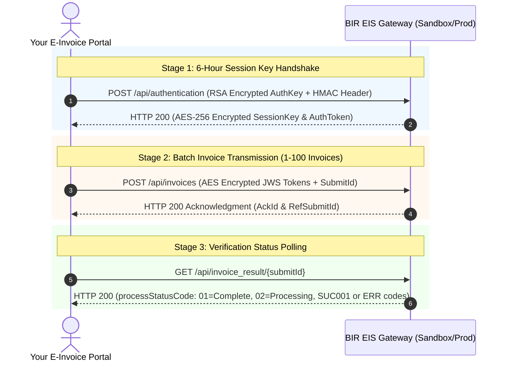

# BIR EIS (Electronic Invoicing System) Certification & Integration Guide
**System:** Multi-Platform E-Commerce E-Invoice Portal (Shopee, Lazada, TikTok Shop)  
**Specification:** BIR EIS e-Invoice API Development Guide for PILOT (Ver. 2.3) & CAS JSON Format v2.2  
**Target Gateways:**
- **Sandbox (Testing):** `https://eis-cert.bir.gov.ph`
- **Production (Live):** `https://eis.bir.gov.ph`

---

## 1. Executive Summary: How BIR EIS Certification Works

Under **Revenue Regulations (RR) No. 8-2022**, **RR No. 9-2022**, and the **Ease of Paying Taxes (EOPT) Act (RA 11976)**:
1. The BIR evaluates your system by testing **live API payload transmissions** against the BIR EIS Sandbox (`https://eis-cert.bir.gov.ph`).
2. Transmitted data must strictly comply with the **54-field Computerized Accounting System (CAS) JSON Schema** (`classes/BirEisClient.php`).
3. Transmission is secured by a **3-tier cryptographic protocol**:
   - **Transport**: HMAC-SHA256 authenticated HTTP headers.
   - **Handshake**: Hybrid RSA-2048 encryption for dynamic 6-hour AES-256 session key exchange.
   - **Document Integrity**: JWS (`RS256`) digital signature per invoice, followed by AES-256-CBC payload encryption.

> **System Status:**  
> Your E-Invoice portal is now **fully equipped with native PHP OpenSSL engines** implementing the exact BIR Pilot v2.3 and CAS JSON v2.2 specifications without requiring third-party cloud intermediaries.

---

## 2. Understanding BIR Identifiers & Credentials

| Setting / Credential | BIR Meaning & Source | Purpose in Portal |
| :--- | :--- | :--- |
| **Accreditation ID** | 8-digit EIS Certificate Number (starts with `20` for CAS, e.g. `20146IT4`). | Identifies system type and builds `EisUniqueId` and `submitId`. |
| **EIS User ID & Password** | Registered login account on `https://eis-cert.bir.gov.ph`. | Encrypted with BIR RSA Public Key during `/api/authentication`. |
| **Application ID** | Registered application identifier on the EIS portal. | Sent in HTTP request header `ApplicationId`. |
| **Application Secret Key** | Shared secret generated in application settings on EIS portal. | Used as key for HMAC-SHA256 signature during authentication. |
| **Digital Signing Key ID (`kid`)** | Key-pair ID generated under application settings. | Embedded in JWS header (`{"alg":"RS256","kid":"..."}`). |
| **Digital Signing Private Key** | Taxpayer's RSA 2048-bit Private Key PEM. | Digitally signs each invoice payload with RSASSA-PKCS1-v1.5 SHA-256. |

---

## 3. The 4-Stage API Call Lifecycle

### Stage 1: Authentication (`POST /api/authentication`)
- Negotiates a 32-character temporary AES key (`authKey`) with the BIR Sandbox.
- The returned `authToken` and `sessionKey` are cached in `einv_settings` for **6 hours**.

### Stage 2: Batch Invoice Transmission (`POST /api/invoices`)
- Can transmit **1 to 100 invoices** in a single batch.
- Each invoice is converted into the 54-attribute CAS JSON, signed with JWS (`RS256`), concatenated with commas, and encrypted with `sessionKey` via AES-256-CBC.
- Generates a 33-character `submitId`: `<AccreditationId>-<YYYYMMDD>-<12_random_hex>`.
- Returns immediate receipt code (`ackId`).

### Stage 3: Result Inquiry (`GET /api/invoice_result/{submitId}`)
- Polls processing status:
  - `02`: Still in processing.
  - `01`: Processing completed. Returns `processedDocuments` with `SUC001` (Success) or specific BIR error codes.
  - `03`: Processing not available / decryption error.

---

## 4. Key Updates in Version 2.3 (July 2026 EOPT Compliance)

1. **Document Types (`DocType`)**:
   - `01`: **Invoice** (Standard for all goods and services under the EOPT Act).
   - `02`: Debit Memo (DM/DN).
   - `03`: Credit Memo (CM/CN).
   - *Codes `04` (Special Billing) and `05` (Official Receipt) are permanently **deleted**.*
2. **Transaction Classification (`TransClass`)**:
   - `01`: VATable (12%)
   - `02`: Zero-Rated (0%)
   - `03`: VAT Exempt
   - `04`: Local Sales of Registered Business Enterprises (RBEs)
3. **Seller Types (`SellerInfo.Type`)**:
   - `0`: VAT Registered
   - `1`: Non-VAT Registered
   - `2`: Registered Business Enterprise (RBE)
4. **New Error Codes**:
   - `ERR011`: Invalid Document Type (e.g. attempting to send 04 or 05).
   - `ERR012`: Invalid Seller Type.
   - `ERR013`: Local Sales of RBEs error (seller is not an RBE).
   - `ERR014`: Transaction classification error.
   - `ERR015`: Seller TIN is not registered as an RBE.
5. **Sandbox Throttle Rule (`E19`)**:
   - Maximum **1 API request per 10 seconds** in Sandbox mode. Calling faster triggers error `E19: Too frequent sandbox requests`.

---

## 5. Using the Invoicing Portal for BIR Certification

### Step 1: Configure Credentials in Settings
1. Open the portal and navigate to **Settings** (`settings.php`).
2. Under **BIR Tax Profile**, ensure your registered Business Name, TIN, Branch Code, and Seller Type are correct.
3. Under **BIR EIS Gateway Configuration**:
   - Set Gateway Status to **Enabled**.
   - Select **Sandbox** (`https://eis-cert.bir.gov.ph`).
   - Enter your **EIS Cert No. (Accreditation ID)**, **User ID**, and **Password**.
   - Enter your **Application ID** and **Application Secret Key**.
   - Enter your **Key-Pair ID (`kid`)** and paste your **RSA Private Key PEM**.
4. Click **Save Tax & EIS Settings**.

### Step 2: Run the Built-in Self-Test Suite
1. Click **Run BIR EIS Sandbox Self-Test** on the Settings page.
2. The system executes all 4 automated diagnostic scenarios:
   - **EIS-TC-01**: CAS Schema 54-field structure & 12% VAT math validation.
   - **EIS-TC-02**: JWS (`RS256`) digital signature generation test.
   - **EIS-TC-03**: RSA & AES-256-CBC cipher round-trip test.
   - **EIS-TC-04**: Live gateway handshake with `https://eis-cert.bir.gov.ph/api/authentication`.
3. You can click **Copy BIR JSON Payload** to inspect the generated CAS JSON.

### Step 3: Transmit Live Test Invoices & Sync Status
1. Navigate to **Invoices History** (`history.php`).
2. Select up to 100 invoices using the table checkboxes.
3. Click **Transmit to BIR EIS**. The portal will digitally sign, encrypt, and submit the batch.
4. After a few minutes, click **Sync BIR EIS** to poll the gateway for validation results (`SUC001`).
